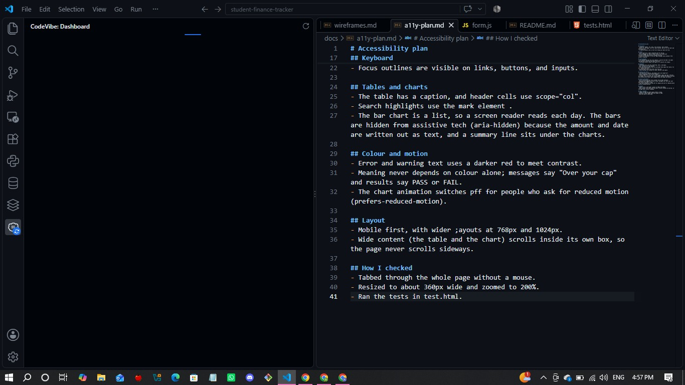
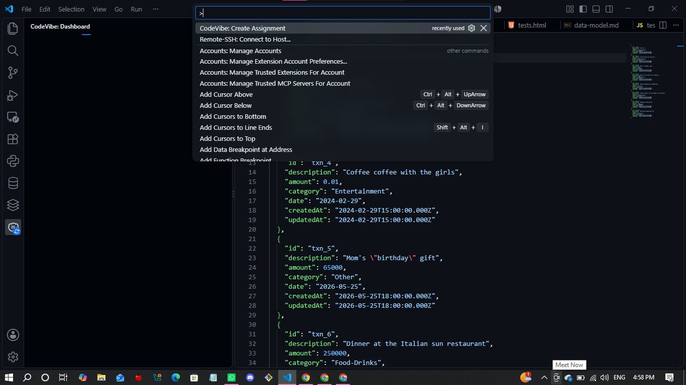
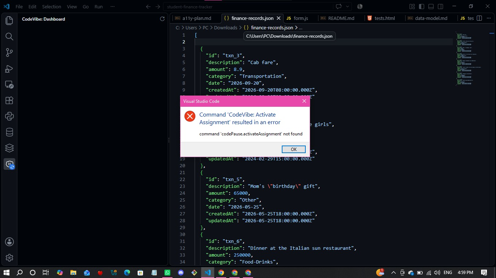
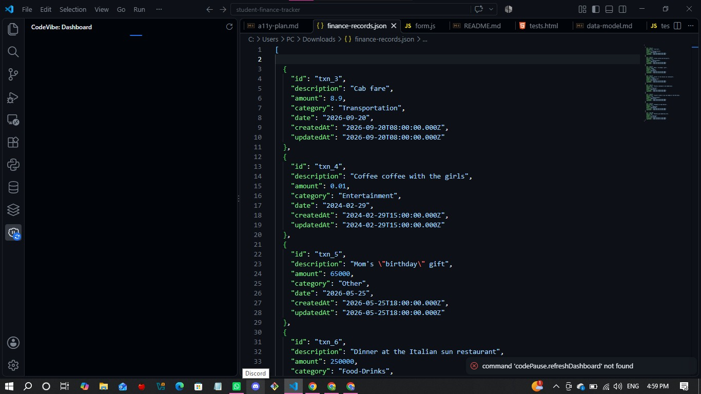

# Student Finance Tracker

A small web app for a student to log spending, see simple stats, and stay under a spending cap. Built with plain HTML, CSS and JavaScript, with no frameworks.

- **Repo:** https://github.com/risaboke/student-finance-tracker
- **Live site (GitHub Pages):** [PAGES LINK]
- **Demo video (unlisted):** [VIDEO LINK]

## Theme
I chose the **Student Finance Tracker** project because it seems quite challenging and would test and grow my JavaScript skills - I also do enjoy making tables using HTML, so this project was a mix of things I like doing and want to learn to integrate into my work. Also, it did help that the summative brief included starter regex patterns and seed examples for it. In this project, the currency settings use Rwandan francs, Kenyan shillings and US dollars, with typed in rates.

## Features
- Add, edit and delete transactions, with every field checked by regex
- Table with sorting by description, amount, category and date (click a header again to reverse)
- Live regex search with a case-sensitive toggle and highlighted matches, and an "invalid pattern" message instead of a crash
- Dashboard: total records, total spent, top category, last-7-days total, and a 7-day bar chart
- Spending cap with a polite live message when under it and an assertive one when over it
- Settings: a base currency plus two others, with exchange rates I type in myself (no API)
- Data saved in the browser (localStorage), plus JSON export and import with validation
- `tests.html` with regex assertions

## Regex catalog
Each pattern is in `scripts/validators.js` and tested in `tests.html`.

- **Description:** `/^(?! )(?!.*  )[a-zA-Z0-9_.,'&()\/\- ]{3,100}(?<! )$/`
  Accepts `Lunch at kivu noir`. Rejects `Lunch  at cafe` (two spaces), ` Lunch` (leading space), `Lunch ` (trailing space), and `Ab` (too short).
- **Amount:** `/^(?!0+$)(?:0|[1-9]\d*)(?:\.\d{1,2})?$/`
  Accepts `12.50`, `0.01` and `250000`. Rejects `0`, `007`, `12.505`, `abc` and `-5`.
- **Category:** `/^[A-Za-z]+(?:[ -][A-Za-z]+)*$/`
  Accepts `Food`, `Eating Out` and `Fun-Fit`. Rejects `Food2`, `-Food` and `Food  Out`.
- **Date:** `/^\d{4}-(0[1-9]|1[0-2])-(0[1-9]|[12]\d|3[01])$/`
  Accepts `2026-10-24` and `2024-02-29`. Rejects `2026-13-01` and `24/10/2026`. It checks the shape of a date only, so `2026-02-31` would pass.
- **Duplicate word (advanced, a warning only):** `/\b(\w+)\s+\1\b/i`
  Uses a back-reference to find a repeated word. `Coffee coffee with the girls` shows a warning, but the form can still be saved.
- **Currency code:** `/^[A-Z]{3}$/`
  Accepts `USD` and `RWF`. Rejects `usd` and `US`.
- **Exchange rate:** `/^(0|[1-9]\d*)(\.\d{1,6})?$/`
  Accepts `0.92`, `1450.5` and `0.00068`. Rejects `abc` and `0.1234567`. A rate of zero is rejected in JavaScript.

The description pattern uses lookaheads and a lookbehind. The amount, category, date and duplicate-word patterns started from the assignment's starter snippets.

## Keyboard map
| Key | What it does |
|---|---|
| Tab / Shift+Tab | Move forward / backward through links, buttons and fields |
| Enter or Space | Press a button (sort, Edit, Delete, Export) |
| Enter in a form | Submit the form |
| Tab, then Enter on the skip link | Jump past the header to the main content |
| Esc | Cancel the delete confirmation |

## Accessibility notes
- Semantic landmarks, one `h1`, and a skip-to-content link
- Every field has a bound label, and error messages are linked with `aria-describedby` and announced with `aria-live`
- The cap has two live regions: polite when under the cap, assertive when over
- Edit and Delete buttons are labelled with the record name
- Visible focus outlines, and error text in a darker red for contrast
- Meaning never relies on colour alone
- The chart is a list with the numbers written out, and the bars are decorative
- The chart animation turns off for people who ask for reduced motion
- Full plan: `docs/a11y-plan.md`. Wireframes: `docs/wireframes.md`. Data model: `docs/data-model.md`.

## How to run it
1. Open the folder in VS Code and start **Live Server** (or use the GitHub Pages link above). Opening `index.html` by double-clicking won't work, because the app loads its scripts as modules and fetches `seed.json`.
2. The first load shows 10 seed records. After that, your data comes from localStorage.
3. To reset, delete the keys starting with `finance-tracker:` in DevTools, under Application, then Local Storage.

## How to run the tests
Open `tests.html` through Live Server (or `/tests.html` on the live site). It shows each regex test with PASS or FAIL and a total at the top. All [NUMBER FROM tests.html] should pass.

To test import, use the files in `assets/`: `invalid-sample.json`, `not-json.json` and `wrong-shape.json` should all be rejected with a message and no change to your data. An exported file should import cleanly.

## Decisions and known limitations
- **Edit** copies a record into the form below the table instead of editing inside the row. I did this so edits go through exactly the same regex validation as new records. There is no cancel button yet.
- **Seed data** skips the form rules on purpose, so a tricky record such as `Mom's "birthday" gift` loads even though the description rule would reject its quote marks.
- **Import** replaces my current data and doesn't merge. A bad file is rejected before anything changes.
- **Exchange rates** are typed in by hand, as the assignment asks. The spending cap is in the base currency.
- **Last 7 days** counts back from today's date, one bar per day.

## What I struggled with

1. **Regex.** In regex101, my patterns showed "no match" because without the `m` flag, `^` and `$` treat my multi-line test box as one line. Adding `gm` fixed it. Later, a rate pattern that ended in `%/` instead of `$/`, and the wrong rules attached to the wrong settings boxes, showed me how much one character matters.

2. **Scope and ids.** I used variables outside the function that created them (`seedRecords`, `total`) and got "is not defined". One wrong id (`data-structures` instead of `data-status`) stopped my import and export message from showing, and I found it by checking the ids in the Console.

3. **The 7-day chart.** "Last 7 days" showed `0.00` because my dates were a month behind: JavaScript counts months from 0, so I needed `+ 1`. I found that by printing the list of dates with `console.log`.

4. **Learning while building, close to the deadline.** I'm new to JavaScript, so I was picking up ideas like async and await, `localStorage` and scope as I used them. My wireframes, data model and accessibility plan were written after the first working version, so they describe the final layout.

5. **The CodeVibe tracker.** I installed it the day after it I was asked to, and was already on Milestone 5, so it only covers my work from that point on. It also crashed toward the end of the project.

## CodeVibe tracker
- Installed on: [15-10-2026]
- Crashed on: [17-10-2026]
- My commit history shows when I reached each milestone: [CHECK WITH `git log` BEFORE YOU WRITE WHICH ONES]

## Credits
- The starter regex patterns and the seed record shapes came from the assignment brief.
- regex101 (https://regex101.com) was used to test my regex patterns.
- RegexOne (https://regexone.com)
