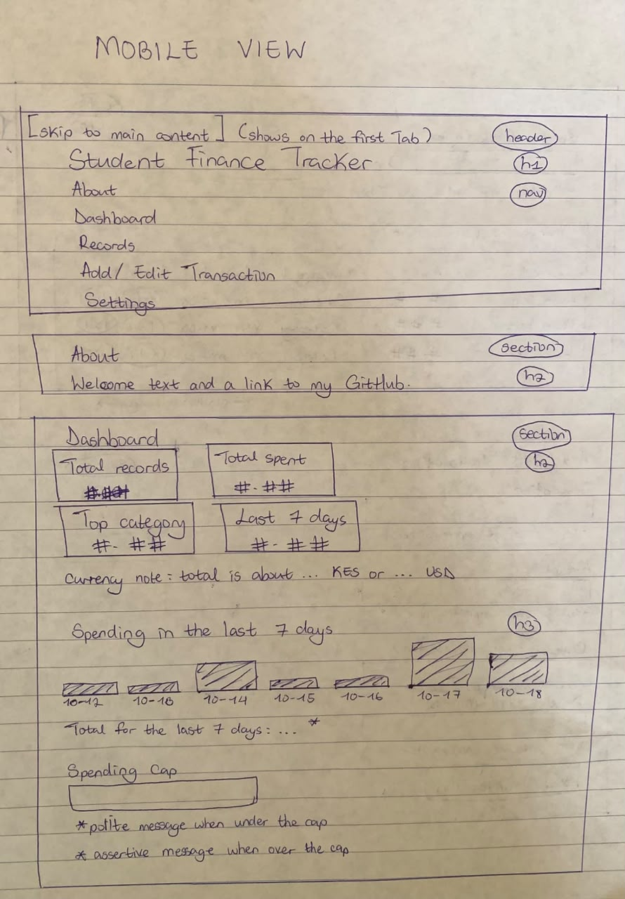
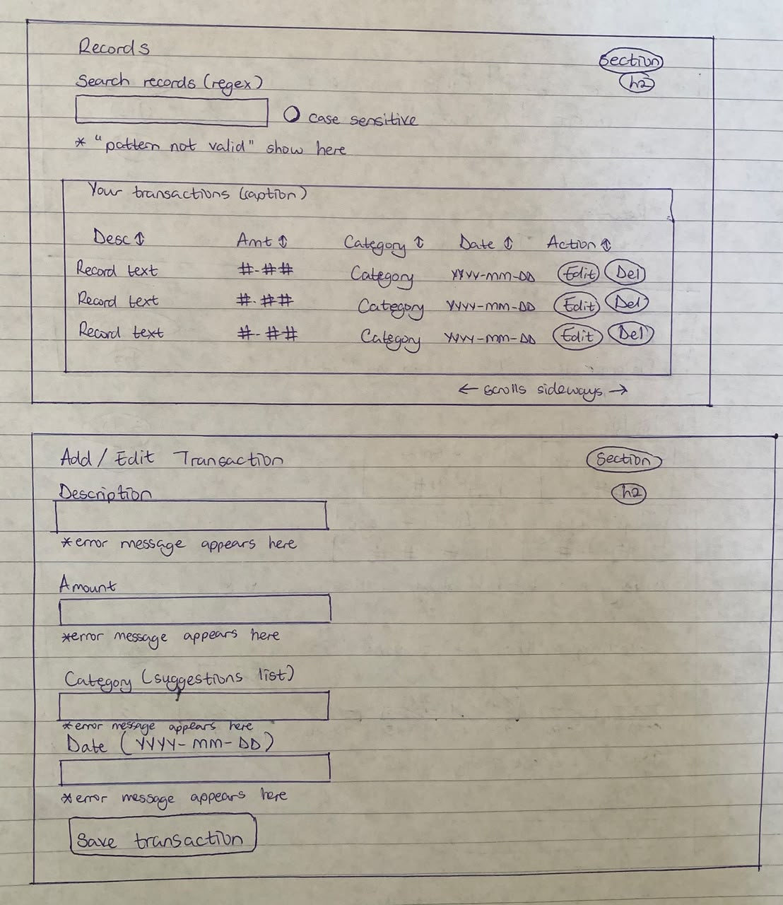
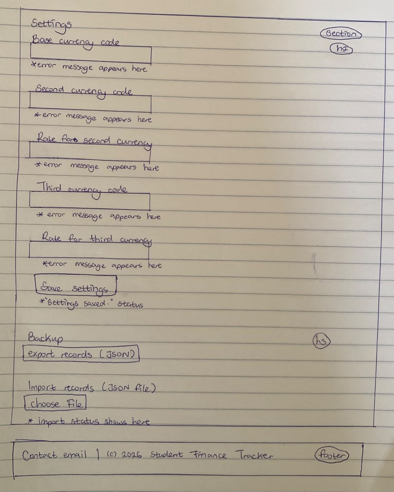
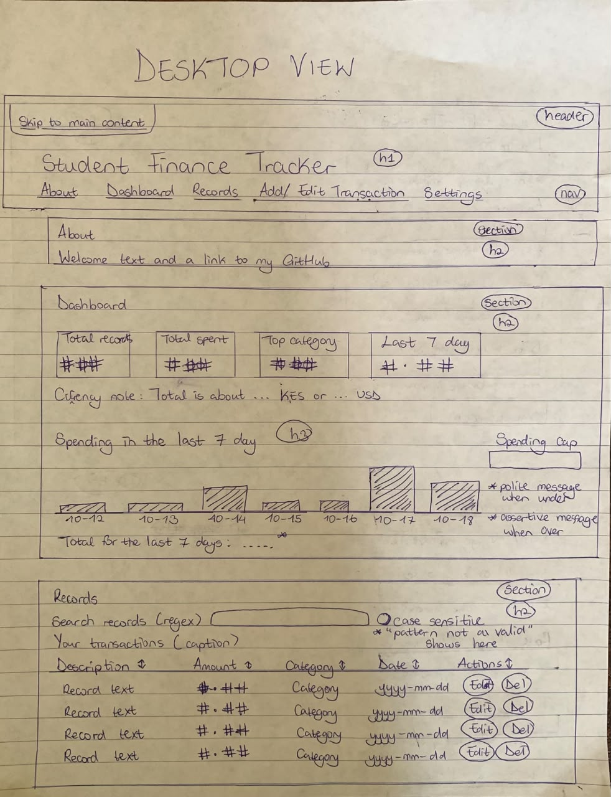
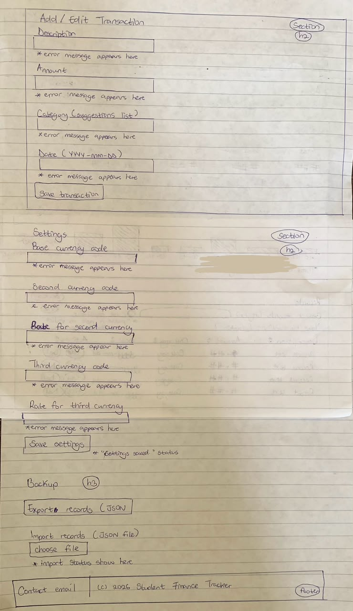

# Wireframes

I drew the wireframes by hand and took photos of both layouts. I wrote up these notes after building the first version, so they describe the layout I ended up with.

## Mobile (single column)

## Desktop (centered column)

## Layout notes

-I started with a mobile layout, where everything is in one column. At 768px and 1024px, the layout adjusts to fit wider screens.
-The page use one continuous scroll with five sections: About, Dashboard, Records, Add/Edit Transaction, and Settings.
-On smaller screens, the table can scroll sideways inside its own container - this keeps the whole page from scrolling horizontally. 

## Tab order

The tabs order starts with the skip link, followed by the five navigation links, spending cap, search box and checkbox, sort buttons, Edit and Delete buttons, the four form fields and Save button, settings fields and Save button, then Export and Import.

## Landmarks and headings

The page uses a header, navigation, main content, five sections, and a footer. There is one h1 for the page title, an h2 for each section, and an h3 for the chart and Backup.